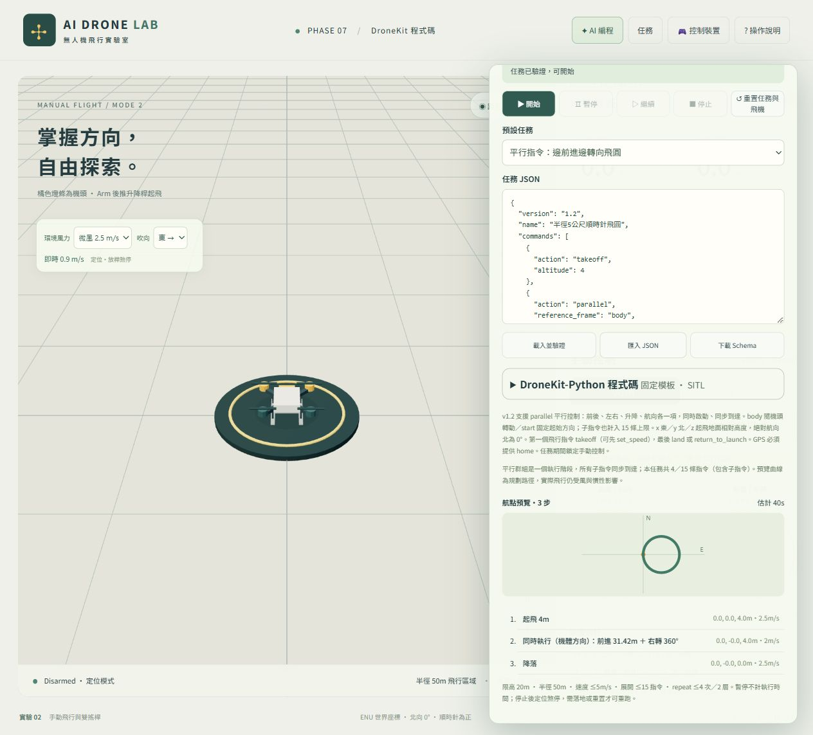
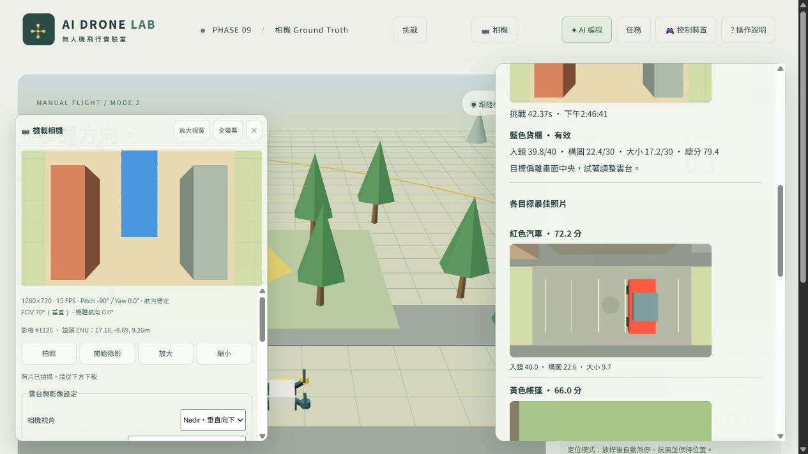

# AI Drone Lab

**網頁式無人機模擬與 AI 編程教學平台。**

[專案簡介](#專案簡介) · [安裝說明](#安裝說明) · [專案架構](#專案架構) · [功能簡介](#功能簡介) · [文件導覽](#進一步閱讀)

## 專案簡介

AI Drone Lab 將 3D 飛行、自然語言編程與挑戰關卡整合在瀏覽器中，適合無人機體驗課程、學生教學及自主練習。使用者可以手動操控無人機，或以繁體中文描述任務，預覽 AI 產生的飛行步驟後執行模擬，也能下載對應的 DroneKit-Python 程式碼進一步學習。

平台以 **React、TypeScript、Three.js 與 Node.js** 建立，提供桌面與手機操作介面。基本飛行、JSON 任務及關卡可獨立使用，不需要 OpenAI 帳號、API Key 或 Python。




## 安裝說明

### 環境需求

- **Node.js 22.12 或以上版本**。
- **pnpm** 套件管理器；尚未安裝時可執行 `npm install -g pnpm`。
- 支援 **WebGL2** 的現代瀏覽器，並啟用硬體加速。
- 使用 AI 功能時需要網際網路及對應的 OpenAI 授權。
- Python 與 ArduPilot SITL 僅在執行下載的 Python 腳本時需要。

### 下載與啟動

1. 從此 GitHub 版本庫下載 ZIP 並解壓縮，或使用 Git clone。
2. 開啟終端機，切換至包含 `package.json` 的專案根目錄。
3. 安裝套件並啟動：

```sh
pnpm install
pnpm dev
```

未放置 HTTPS 憑證時，開啟 <localhost:5173/>。 `pnpm dev` 會同時啟動前端與 AI 後端，按 `Ctrl+C` 可停止兩者，不需另外啟動後端。

若連接埠已被使用，可停止舊程序或指定其他前端連接埠：

```sh
pnpm dev --port 5174
```

請以終端機顯示的實際網址為準。未設定 AI 授權也能使用手動飛行、JSON 任務、相機與挑戰關卡。

### AI 設定（選用）

平台提供兩種來源，使用者須在「AI 編程」中明確選擇，不會自動切換來源。

| 來源 | 設定方式 | 使用範圍 |
| --- | --- | --- |
| OpenAI API Key | 在後端設定自己的金鑰 | 本機或已設定的區網／網站服務 |
| ChatGPT 方案登入 | 在介面完成自己的登入與授權 | 實驗性功能，僅限同一台電腦本機使用 |

**API Key 模式**

將 `server/.env.example` 複製為 `server/.env`：

```powershell
# Windows PowerShell
Copy-Item server/.env.example server/.env
```

```sh
# macOS / Linux
cp server/.env.example server/.env
```

編輯 `server/.env`，填入 `OPENAI_API_KEY`，再啟動或重新啟動 `pnpm dev`。請勿將金鑰放入 `VITE_*` 變數或提交至 GitHub。

在「AI 編程」選擇 API Key 來源，按「更新 API 模型清單」即可選擇模型；未選擇時使用後端 `OPENAI_MODEL`。所選模型需支援 Responses API 與 Structured Outputs，清單可見不代表功能一定相容。

**ChatGPT 方案模式**

使用同一台電腦的 `http://localhost:5173/` 開啟平台；若已設定 HTTPS，可用 `pnpm dev:http` 啟動本機 HTTP 模式。在「AI 編程」選擇「ChatGPT 方案（本機登入）」並按 `Continue with ChatGPT`，由帳號本人完成授權後選擇模型。可用性依帳號與授權結果而定；此模式不提供其他裝置共用。

### 手機與 HTTPS

前後端預設監聽 `0.0.0.0`。使用 `pnpm dev:http` 啟動後，同一區網的手機可透過 `http://電腦的區網IP:5173/` 開啟；主機防火牆須允許連線，建議手機橫向操作。

若需要受信任 HTTPS，請自行準備符合網域的 PEM 憑證：

```text
ssl/
  server-fullchain.pem
  server-privatekey.pem
```

`pnpm dev` 偵測到完整憑證後會自動使用 HTTPS，也可使用 `pnpm dev:https` 明確要求 HTTPS。瀏覽器須開啟憑證涵蓋的網域；憑證與私鑰不包含在版本庫中。

Android Chrome 可從受信任 HTTPS 網址安裝為 Web App。安裝後仍需連線至服務，未提供離線快取。

### 建置與測試

```sh
pnpm build          # 型別檢查、生成教學範例並輸出 dist/
pnpm test           # 自動化回歸測試
pnpm check:upload   # Git 上傳候選檔案的隱私與秘密樣式檢查
```

正式部署可將 `dist/` 放至 HTTPS 網頁伺服器。若需要 AI 功能，須另外啟動 Node.js 後端（`pnpm start:server`），將同源 `/api/ai` 路由代理至後端，並設定 `AI_ALLOWED_ORIGINS`；純靜態網站不會包含 AI 後端功能。

## 專案架構

### 技術組成

| 範圍 | 技術與用途 |
| --- | --- |
| 前端 | React 19、TypeScript、Vite：操作介面與建置 |
| 3D 與幾何 | Three.js：場景、相機、投影與射線可見性估計 |
| 飛行與任務 | 純 TypeScript 運動模型、JSON Schema、Ajv 驗證 |
| AI 後端 | Node.js、OpenAI Responses API、Structured Outputs |
| 本機資料 | localStorage 儲存成績、IndexedDB 儲存攝影尋寶縮圖 |
| Python 匯出 | 固定模板產生 DroneKit-Python／MAVLink 腳本 |
| 自動測試 | Node.js test runner、tsx、jsdom；Python 控制函式庫另有測試 |

### 目錄結構

```text
AI Drone Lab/
├─ src/
│  ├─ core/            飛行狀態、運動模型、座標與風場
│  ├─ input/           鍵盤、觸控與實體手把輸入
│  ├─ render/          3D 場景、無人機與觀察攝影機
│  ├─ missions/        任務型別、Schema、驗證與執行器
│  ├─ ai/              AI 請求與前端回應驗證
│  ├─ camera/          機載相機、雲台、影像與錄影
│  ├─ groundTruth/     目標管理、投影、可見性與同步快照
│  ├─ challenges/      關卡註冊、場景、規則、計分與成績
│  ├─ dronekit/        Python 腳本生成與步驟對照
│  ├─ components/      操作介面
│  └─ config/          共用限制
├─ server/             AI 後端、模型清單與本機登入
├─ python/             DroneKit 控制函式庫與相容套件清單
├─ scripts/            啟動、HTTPS、範例匯出與檢查工具
├─ public/             圖示、任務與可下載 Python 範例
├─ tests/              正式自動化回歸測試
├─ docs/               功能文件、架構與圖片
└─ server/.env.example 後端設定範例
```

### 資料流與模組分工

```text
鍵盤／搖桿 ────────────────────────┐
                                 ↓
中文任務 → AI 後端 → JSON → 共用驗證 → 任務執行器 → FlightModel → 3D 場景
                          └─→ 固定模板 → Python 腳本 → 本機 SITL（另行執行）
                                                       
3D 場景 + 機載相機 → 拍攝瞬間快照 → Ground Truth → 關卡拍照評分
FlightModel 實際狀態 ────────────────────────────→ 關卡規則與計分
```

手動與自動任務共用飛行模型，渲染讀取模擬狀態；相機與關卡不另建飛行邏輯。共用世界座標為 **ENU（東、北、上）**、公尺制；航向北為 0°，順時針為正。任務的本地座標以起飛點為水平原點，高度相對起飛地面。

AI 後端只處理任務解析與授權，不執行 AI 產生的任意程式碼。Ground Truth 由場景與實際拍攝相機計算，不提供隱藏座標給 AI 任務規劃器。瀏覽器端隔離用於防止一般介面誤用，不構成真正的安全邊界。

## 功能簡介

### 3D 飛行與手動控制

- Low-poly 場景、起降平台、飛行邊界及即時飛行儀表。
- 機身傾斜、慣性、風場與陣風效果。
- 定位模式與具定高輔助的姿態模式。
- 第三人稱跟隨／固定視角，以及整頁全螢幕。
- 鍵盤、手機 Mode 2 雙虛擬搖桿及 Xbox／PS5 標準映射手把。

按 **Arm** 啟動馬達，再控制上升自行起飛；可手動下降或按「降落」，落地後按 **Disarm** 停槳。定位模式放開控制會煞停並保持位置；姿態模式仍會受風與慣性漂移。

| 鍵盤 | 功能 |
| --- | --- |
| W / S | 上升／下降 |
| Q / E | 左轉／右轉 |
| ↑ / ↓ | 前進／後退 |
| ← / → | 左右平移 |
| R | 重置 |

手機左搖桿控制升降與轉向，右搖桿控制水平移動；支援同時操作兩個搖桿。實體手把從「控制裝置」選擇，選用後隱藏虛擬搖桿。

### 自動任務與 AI 中文編程

- 載入、編輯及匯入 JSON 任務，提供預設任務與路徑預覽。
- 起降、平移、轉向、定高、本地／GPS 航點、速度設定與返航。
- `parallel` 支援同時移動與轉向，可規劃圓弧及螺旋路徑。
- 開始、暫停、繼續、停止、重置及重新執行。
- 中文描述轉為結構化任務，確認步驟後才開始模擬。

例如：

> 起飛到 5 公尺，向前飛 10 公尺，右轉 90 度，再前進 5 公尺，最後降落。

AI 與手動編寫的 JSON 使用相同驗證流程。預設任務限高 **20m**、水平半徑 **50m**、速度 **5m/s**、展開最多 **15 條指令**，有效執行時間最多 **180 秒**。AI 目前不會自動規劃繞過場景障礙物的路徑。

### 機載相機與雲台

- FPV、垂直俯拍、斜拍及自訂角度。
- Pitch／Yaw、機體跟隨／航向穩定、FOV、解析度及更新頻率設定。
- 即時預覽、相機全螢幕、拍照下載及瀏覽器支援時的錄影下載。
- 自動任務可控制雲台、拍照與錄影。
- 手機預覽依可用空間調整大小。

### 挑戰關卡

手動、AI 任務及混合控制共用相同判定，成績與最佳紀錄儲存在目前瀏覽器。

| 關卡 | 玩法 | 評分方式 |
| --- | --- | --- |
| 航線競速 | 依序通過航點 | 完成時間、偏離加時與模式規則，等效時間越低越好 |
| 精準降落 | 降落於指定目標區 | 依實際落點誤差計分，越高越好 |
| 攝影尋寶 | 探索小鎮，拍攝紅車、黃帳篷與藍貨櫃 | 有效入鏡、構圖與目標大小，各目標保留最佳照片 |



### DroneKit-Python 程式碼生成

將已驗證的飛行任務轉為可閱讀的 Python 指令，提供語法高亮、步驟與底層 DroneKit／MAVLink 呼叫對照、複製及完整 `.py` 下載。介面內附 Python 環境、啟動 SITL 與執行腳本的簡短說明。

腳本預設僅檢查，須明確指定執行參數才會連線本機 SITL。含相機指令的任務目前不支援 Python 匯出；Python、DroneKit 與 ArduPilot 韌體須採相容版本。SITL 驗證僅涵蓋文件記錄的環境與任務，不代表可直接安全實飛。詳見 Python 生成與執行。

### 目標管理與 Ground Truth

提供可重用的目標註冊、3D／2D 邊界框投影、遮擋與可見比例估計，以及照片與標註同步快照。開發者可用 `?developer=1` 開啟除錯工具並匯出標註，供資料集與後續視覺功能使用；一般玩家預設不顯示 Ground Truth。

目前未整合 YOLO 推論或 AI 自主視覺搜尋。

## 常見問題

- **網頁無法開啟**：確認在專案根目錄啟動、前端 5173 與後端 3001 未被占用，並以終端顯示的網址連線。
- **手機無法連線**：確認同一區網、防火牆與電腦 IP；使用 HTTPS 時網址必須符合憑證網域。
- **AI 無法產生任務**：檢查來源、授權及模型選擇，保留輸入後重試；預設任務與手動飛行仍可使用。
- **Python 執行後沒有飛行**：`--check` 只做檢查。須先啟動相容 SITL，再以 `--execute-sitl` 執行；完整指令與相容性見 Python 文件。
- **清除瀏覽器資料後成績消失**：成績與照片縮圖儲存於目前瀏覽器，尚未提供跨裝置帳號同步。

## 使用與開發指南

| 主題 | 快速操作 | 完整文件 |
| --- | --- | --- |
| JSON 任務 | 任務 → 貼上／匯入 JSON → 載入並驗證 → 預覽 → 開始 | [格式、全部動作、限制與範例](docs/mission-system.md) |
| 關卡開發 | 定義資料 → 場景／規則／計分插件 → Catalog 註冊 → 測試與匯出 | [開發流程與介面](docs/challenge-development.md) |
| Ground Truth | 網址加 `?developer=1` → 開發者 GT → 拍照與計算 → 匯出 PNG／JSON／YOLO | [操作、資料格式與整合方式](docs/ground-truth.md) |
| AI 編程 | 選來源與模型 → 輸入完整中文任務 → 產生並確認步驟 → 開始模擬 | [設定、提示範例與限制](docs/ai-programming.md) |

### JSON 任務快速範例

```json
{
  "version": "1.2",
  "commands": [
    {"action": "takeoff", "altitude": 5},
    {"action": "move_forward", "distance": 10},
    {"action": "turn_right", "angle": 90},
    {"action": "land"}
  ]
}
```

距離為公尺、角度為度、時間為秒；本地 x 東／y 北／z 上，平移依機頭方向。任務必須有起飛與最終降落／返航，不接受未支援動作。單步最多 60 秒、任務最多 180 秒；repeat、航點、返航與 parallel 子動作展開後合計最多 15 條。

AI 解析另有限制：輸入最多 1,000 字元（含關卡公開資訊），API Key 後端最多等待 25 秒，ChatGPT 最多 60 秒；預設每 IP 每分鐘 30 次、每小時 120 次。AI 與自行編寫的任務共用安全驗證，不具自主避障能力。

## 進一步閱讀

- [JSON 任務系統](docs/mission-system.md)與平行任務（同份指南）
- [關卡開發](docs/challenge-development.md)（含攝影尋寶整合原則）
- [Ground Truth 與影像標註](docs/ground-truth.md)